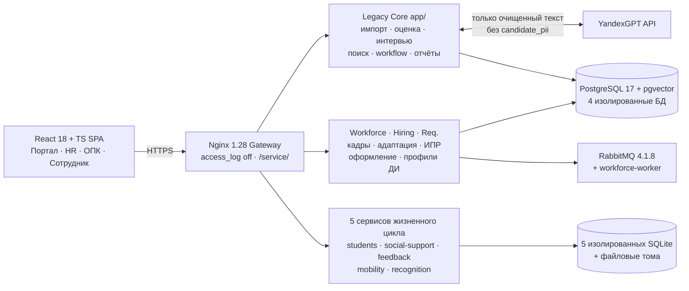

# Кадровый ассистент — ИИ-платформа для кадровой службы администрации Нижнего Новгорода

Единая цифровая среда для полного цикла работы с кадрами в органах местного самоуправления: приём и очистка резюме с изоляцией персональных данных, формальная оценка по должностным инструкциям с верификацией цитат, гайд телефонного интервью, контроль сроков ответа департаментов (10 рабочих дней), поиск по кадровому архиву, оформление документов, адаптация, ИПР, практика студентов, материальная помощь, анонимные опросы и годовой кадровый доклад в Excel. Прототип команды № 9 (GORKY) для финала хакатона «Горький код».

**Работающий стенд (для ноутбука / десктопа):** https://gorky.bond · **Документация API (Swagger):** [подбор и отчётность](https://gorky.bond/legacy/docs) · [кадры и адаптация](https://gorky.bond/workforce/docs) · [требования](https://gorky.bond/requirements/docs) · [оформление](https://gorky.bond/hiring/docs) · [практика](https://gorky.bond/students/docs) · [матпомощь](https://gorky.bond/social-support/docs) · [опросы](https://gorky.bond/feedback/docs) · [мобильность](https://gorky.bond/mobility/docs) · [признание](https://gorky.bond/recognition/docs)

**Статья (PDF)** — архитектура, пайплайн оценки с верификацией цитат, сравнение поиска BM25 vs E5, модель полноты отчётности, алгоритм Куна и замеры качества: **[`docs/paper/kadry-paper.pdf`](docs/paper/kadry-paper.pdf)**. Кратко: на реальном архиве из 1 739 файлов (287 DOCX папки «консультант») реестр публикаций отсекает 7,3 % откликов на чужие должности и 15,7 % файлов без подвала до вызова LLM; живой прогон формальных правил на YandexGPT прошёл **41 из 41 кейса** (0 ошибок модели, `assessment-2.0.2`); поиск BM25 работает в **6,4 раза быстрее** E5 (4,33 против 27,50 мс) при нуле ложных срабатываний; в репозитории **109 тестовых файлов** (до 898 passed в полном прогоне ядра).

**Путеводитель для нетехнических проверяющих (без жаргона):** **[`docs/PRODUCT-GUIDE.md`](docs/PRODUCT-GUIDE.md)** — пошаговые 2-минутные маршруты для всех 4 ролей на сайте, таблица покрытия 11 проблем кейса и карта достоверности данных.

**Вход на стенде в 1 клик:** на https://gorky.bond в самой верхней тёмной панели **`Учебные роли:`** можно мгновенно переключаться между 4 кабинетами (**`Портал соискателя`**, **`Сотрудник по подбору персонала`**, **`ОПК`**, **`Сотрудник`**) без ввода пароля. На стенде используются вымышленные учебные данные (`contour=training`), чтобы не раскрывать персональные данные граждан.

---

## Как посмотреть за 3 минуты

| Роль на сайте | Что нажать | Что произойдёт на сервере |
|---|---|---|
| **Портал соискателя** | `Вакансии` → карточка → `Откликнуться`; `Студентам` → `Откликнуться`; `Мои отклики` | Вакансии читаются из каталога сервера; отклик с PDF и ссылкой на 152-ФЗ сохраняется в `hiring`; заявка и задания практики — в `students` |
| **Сотрудник по подбору персонала (HR)** | `Отклики по вакансиям` (светофор 🟢🟡🔴⚪) → `Открыть` → клик по синей цитате `«…» ↗` | Откроется очищенное резюме с жёлтой подсветкой точной цитаты (UTF-16); из карточки открывается `Телефонное интервью` с вопросами по пробелам оценки |
| **Сотрудник по подбору персонала (HR)** | `Единая база` → профиль → `Направить в департамент`; `Архив кадров` → поиск по полю `Нужный опыт` | Фиксируется передача со сроком **10 рабочих дней** по производственному календарю; архив ищет по опыту через BM25 с подсветкой фрагмента |
| **Сотрудник по подбору персонала (HR)** | `Требования и вакансии` · `Оформление` · `Аналитика` → `Годовой доклад` → `Скачать годовой XLSX` | Версионирование ДИ и публикация вакансий; проверка комплекта документов при приёме; выгрузка многостраничного Excel с диаграммами из неизменяемого SHA-256 снимка |
| **ОПК (руководитель подразделения)** | `Мои кандидаты` → выбор передачи → `Ответ сотруднику по подбору персонала`; `Аналитика` | Видны только кандидаты своего подразделения и счётчик просрочки (10 раб. дней); ответ мгновенно закрывает ожидание у HR |
| **Сотрудник** | `Рабочее пространство` (`Адаптация`, `Открыть цели и планы`), `Материальная помощь`, `Опросы` | Прохождение шагов адаптации и ИПР в `workforce`, подача приватного заявления в `social-support`, анонимное голосование по одноразовому коду в `feedback` |

Полная карта всех кнопок, включая честную разметку заглушек «Будет добавлено позже», — в [`docs/PRODUCT-GUIDE.md`](docs/PRODUCT-GUIDE.md).

---

## Запуск локально

### Вариант 1 · Полный стек из 9 сервисов (как на стенде)

**Нужно:** Docker Engine, Docker Compose v2 и Python 3 на хосте.

```bash
git clone https://github.com/team-gorky-9/hr.git
cd hr
python3 deploy/create-env.py deploy/local/runtime.env --release local
docker compose --env-file deploy/local/runtime.env -f deploy/compose.yaml --parallel 2 build
docker compose --env-file deploy/local/runtime.env -f deploy/compose.yaml up -d --wait --wait-timeout 240
python3 deploy/smoke.py
bash deploy/seed-roles.sh deploy/local/runtime.env
```

После запуска шлюз Nginx слушает `http://127.0.0.1:8080/<service>/` (например, `http://127.0.0.1:8080/legacy/docs`, `/workforce/docs`, `/hiring/docs`). Ключи YandexGPT (`YANDEX_API_KEY`, `YANDEX_FOLDER_ID`) опциональны: без них все остальные функции работают штатно, а вызовы LLM возвращают `409`/`503` вместо `500`. Подробнее о деплое, бэкапах и проверках — [`docs/modules/deployment.md`](docs/modules/deployment.md).

Для локального фронтенда (Node.js 20+):
```bash
cd frontend
npm ci --no-audit --no-fund
npm run dev
```

### Вариант 2 · Быстрый запуск ядра подбора (`app/`) без всех микросервисов

**Нужно:** Python 3.13, [uv](https://docs.astral.sh/uv/) и Docker (для PostgreSQL + pgvector).

```bash
cp .env.example .env                  # Windows: Copy-Item .env.example .env
docker compose up -d db
uv sync --locked
uv run alembic upgrade head
uv run python -m app.db.seed
uv run python -m scripts.demo_setup --no-llm
uv run uvicorn app.main:app --host 127.0.0.1 --port 8000 --reload
```

Проверка: `GET http://127.0.0.1:8000/api/v1/health` и Swagger `http://127.0.0.1:8000/docs`. Инструкции отдельного запуска `workforce`, `requirements`, `hiring`, `students`, `social-support`, `mobility`, `recognition` и `feedback` (с обязательной изоляцией корневого `.env`) — в [`docs/demo/wave-6-runtime.md`](docs/demo/wave-6-runtime.md).

---

## Архитектура



- **Фронтенд (`frontend/`, React 18 + TypeScript + Tailwind + Vite)** — 4 рабочих кабинета; подключён к **7 из 9** сервисов (`mobility` и `recognition` сейчас работают как API-only; раздел `Забота и мотивация` в UI честно отмечен «Будет добавлено позже»).
- **Шлюз (`deploy/nginx.conf`)** — Nginx 1.28, снимает префикс `/<service>/`, отключает `access_log` (защита URL с одноразовыми кодами опросов и ID приватных дел), обнуляет внутренние заголовки от браузера, лимит загрузки 21 MiB.
- **Ядро подбора и отчётности (`app/`)** — импорт и очистка резюме (`ingest/`), версионный реестр публикаций (`postings/`), профили требований (`requirements/`), оценщик с верификацией цитат и светофором (`assessment/`), генератор гайда интервью (`interview/`), поиск по опыту (`search/`), передачи со сроком 10 раб. дней (`api/handoff.py`), оперативная аналитика (`api/analytics_read.py`), иммутабельный годовой отчёт с Excel (`reporting/`) и управленческое планирование с алгоритмом Куна (`management/`).
- **PostgreSQL-сервисы (`services/workforce`, `requirements`, `hiring`)** — кадры, оргструктура, адаптация, ИПР (с RabbitMQ + `workforce-worker`), версионирование ДИ и каталог вакансий, кабинет кандидата и оформление документов. Работают на общей отзываемой Bearer-сессии `workforce` (её же использует `students`).
- **Сервисы жизненного цикла (`services/students`, `social-support`, `feedback`, `mobility`, `recognition`)** — практика студентов, приватная материальная помощь, анонимные опросы с одноразовыми кодами и подавлением малых групп + именные обращения, внутренняя мобильность, признание и семейные события.
- **Серверное единое окно (этап 2, `app/api/interaction.py` + `services/hiring/hiring/interaction_window.py`)** — реализовано в коде и проверено в ASGI-тестах (миграция `0014`, HMAC-SHA256 пагинация, `FeedbackReview`, деградация `partial`), в продовом `deploy/compose.yaml` намеренно выключено по умолчанию (`deploy/compose.interaction.yaml`) до подключения отдельного UI.

Подробная схема, таблица всех 9 сервисов, модель авторизации и эксплуатации — в **[`docs/ARCHITECTURE.md`](docs/ARCHITECTURE.md)**.

### Структура репозитория

```text
app/                     Ядро подбора и отчётности (Python 3.13, FastAPI)
├── ingest/              импорт TXT/DOCX/PDF, карантин сканов, редакция ПДн (pymorphy3), аудит
├── postings/            детерминированный реестр публикаций v2 (до вызова LLM)
├── requirements/        загрузчик профилей должностей и явное утверждение HR
├── assessment/          оценка (assessment-2.0.4), верификатор цитат UTF-16, стаж [L,U], светофор
├── interview/           гайд телефонного интервью по пробелам (guide-v2), ревизии ответов
├── search/              поиск по опыту: BM25 + опциональный multilingual-e5-small (pgvector) + RRF
├── reporting/           иммутабельные SHA-256 годовые снимки, модель полноты, Excel (xlsxwriter)
├── management/          адаптер отчёта 4B, сводка 4A и плановые срезы 4C (паросочетание Куна)
├── api/, db/, schemas/  HTTP-маршруты, SQLAlchemy 2, журнал VIEW_PII, производственный календарь
services/                8 самостоятельных FastAPI-сервисов этапа 1
├── workforce/           кадры, оргструктура, адаптация, ИПР, сессии, RabbitMQ worker
├── requirements/        версионирование ДИ, согласование и публикация вакансий
├── hiring/              кабинет кандидата, обращения, оформление комплекта документов
├── students/            практика, заявки, задания наставника, итоги вуза
├── social-support/      приватные заявления на материальную помощь, выписки, исполнение
├── feedback/            анонимные пульс-опросы (одноразовые коды), меры, именные обращения
├── mobility/            временные внутренние задачи, согласование времени, переходы (API)
└── recognition/         благодарности, номинации, семейные события, сессии и материалы (API)
frontend/                React 18 + TypeScript + Tailwind + Vite (4 рабочих кабинета)
deploy/                  Docker Compose (9 сервисов + PG17 + RabbitMQ + Nginx), бэкапы, smoke
fixtures/                учебные наборы, 6 профилей по реальным ДИ (all_six), синтетика поиска
migrations/, tests/      15 миграций Alembic ядра; 66 + 43 = 109 тестовых файлов pytest
docs/                    статья (PDF/LaTeX), путеводитель, архитектура, замеры, контракты, отчёты
.github/workflows/       CI/CD бэкенда (GHCR, smoke) и фронтенда
```

---

## Технологии и почему

| Что | Выбрали | Почему |
|---|---|---|
| Язык и API | Python 3.13, FastAPI, Pydantic v2, `uv` | Единый контракт, строгая валидация и автоматический OpenAPI `/docs` на каждом из 9 сервисов |
| База данных | PostgreSQL 17 + `pgvector` (4 изолированные БД) + SQLite для 5 сервисов этапа 1 | Изоляция прав по БД без `superuser`, реляционные данные + векторы в одном кластере; SQLite позволил быстро довести 5 новых сервисов этапа 1 до рабочего API |
| LLM и оценка | YandexGPT API (`yandexgpt/latest`), `assessment-2.0.4`, верификация цитат кодом | Отечественный провайдер без зарубежной зависимости; LLM извлекает факты и цитаты строго из очищенного текста, а проверку цитат, стаж $[L, U]$ и светофор выполняет детерминированный код |
| Защита ПДн (152-ФЗ) | Правила + `pymorphy3`, отдельная `candidate_pii`, `app.ingest.audit`, журнал `VIEW_PII` | Персональные данные никогда не покидают периметр в LLM; доступ HR к контактам аудируется, руководитель (`ОПК`) видит обезличенную сводку |
| Поиск по опыту | BM25 (`k1=1.2, b=0.75`) по умолчанию; `multilingual-e5-small` + RRF под флагом | На контрольном бенчмарке BM25 дал 6/7 релевантных за 4,33 мс (0 ложных), а E5 на строгом пороге 0,94 не улучшил выдачу при задержке 27,5 мс и 26,2 с холодной загрузки |
| Отчётность и планирование | Контент-адресуемые SHA-256 снимки, `xlsxwriter`, паросочетание Куна | Неизменяемый годовой доклад, математическое различение `0 complete` и `null unavailable`, нативные графики Excel, исключение двойного учёта кандидатов |
| Очереди и воркеры | RabbitMQ 4.1.8 + `workforce-worker` (outbox/inbox) | Надёжная асинхронная доставка кадровых событий и фундамент для автоматизации стыка `Hiring → Workforce` |
| Интерфейс и доставка | React 18, TypeScript, Tailwind CSS, Nginx 1.28, Docker Compose, GitHub Actions → GHCR | Сборка образов в CI (экономия диска VPS), non-root `UID 10001`, `cap_drop: [ALL]`, `backup.sh` и `smoke.py` |

---

## Что сделано (честная матрица)

| Возможность / модуль | В UI на стенде (`gorky.bond`) | В API / CLI и тестах | Где посмотреть |
|---|---|---|---|
| Импорт TXT/DOCX/PDF, карантин сканов, очистка ПДн + аудит | Данные в БД, журнал `VIEW_PII` *(кнопка загрузки в UI — далее)* | **Да** (1 739 файлов / 1 721 резюме) | [`docs/modules/ingest.md`](docs/modules/ingest.md) |
| Профили требований, 6 реальных ДИ, реестр публикаций v2 | **Да** (`Требования и вакансии`, 6 профилей как `draft` / учебные копии) | **Да** (`services/requirements`, `app/postings/`) | [`fixtures/requirement_profiles/all_six/`](fixtures/requirement_profiles/all_six/README.md) |
| Оценка с верификацией цитат UTF-16, стаж `[L,U]`, светофор, кросс-оценки | **Да** (`Отклики по вакансиям`, профиль, жёлтая подсветка цитат) | **Да** (`assessment-2.0.4`, 41/41 live на `2.0.2`) | [`docs/modules/assessment.md`](docs/modules/assessment.md) |
| Гайд телефонного интервью по пробелам + фиксация ответов и итога | **Да** (`Телефонное интервью` из карточки отклика) | **Да** (`guide-v2`, ревизии, матрица оснований) | [`docs/modules/interview.md`](docs/modules/interview.md) |
| Передача в департамент, SLA 10 раб. дней, переносы, отзыв ОПК | **Да** (`Единая база`, профиль HR, кабинет `ОПК`) | **Да** (производственный календарь, `expected_seq`) | [`docs/contracts/workflow.md`](docs/contracts/workflow.md) |
| Кадровый архив, поиск по опыту и повторное рассмотрение | **Да** (`Архив кадров`, BM25 с подсветкой фрагмента) | **Да** (BM25 + опциональный E5 + RRF) | [`docs/modules/search.md`](docs/modules/search.md) |
| Портал соискателя, кабинет кандидата и оформление комплекта документов | **Да** (`Портал соискателя`, `Мои отклики`, `Оформление`) | **Да** (`services/hiring`, 50 тестов) | [`docs/modules/hiring-service.md`](docs/modules/hiring-service.md) |
| Практика студентов (места, заявки, задания, оценка наставника, вуз) | **Да** (`Студентам`) | **Да** (`services/students`, волна 6A) | [`docs/modules/students-service.md`](docs/modules/students-service.md) |
| Оперативный дашборд + неизменяемый Годовой доклад + Excel | **Да** (`Аналитика` в HR и `ОПК`, выгрузка `.xlsx`) | **Да** (SHA-256 снимки, `xlsxwriter`, 4A–4C + Кун) | [`docs/modules/reporting.md`](docs/modules/reporting.md) |
| Адаптация и индивидуальный план развития (ИПР) | **Да** (`Сотрудник` → `Рабочее пространство`, `Развитие`) | **Да** (`services/workforce`, PG17 + RabbitMQ) | [`docs/modules/workforce-service.md`](docs/modules/workforce-service.md) |
| Приватная материальная помощь | **Да** (`Сотрудник` → `Материальная помощь`) | **Да** (`services/social-support`, волна 6B) | [`docs/modules/social-support.md`](docs/modules/social-support.md) |
| Анонимные пульс-опросы (одноразовые коды, скрытие малых групп) | **Да** (`Сотрудник` → `Опросы`) | **Да** (`services/feedback` + именные обращения) | [`docs/modules/employee-feedback.md`](docs/modules/employee-feedback.md) |
| Внутренняя мобильность и временные задачи | Нет *(в развитии)* | **Да** (`/mobility/docs`) | [`docs/modules/mobility-service.md`](docs/modules/mobility-service.md) |
| Признание, номинации, семейные события, сессии | Витрина в `Забота и мотивация` («Будет добавлено позже») | **Да** (`/recognition/docs`) | [`docs/modules/recognition.md`](docs/modules/recognition.md) |
| Единое окно ожиданий (этап 2) | Нет *(в развитии)* | **Да** (выключено в проде, профиль `compose.interaction.yaml`) | [`docs/modules/interaction-window.md`](docs/modules/interaction-window.md) |
| Официальный конкурсный резерв, психометрика, OCR сканов | Честно помечено «Будет добавлено позже» | Нет *(в роадмапе)* | [`docs/PRODUCT-GUIDE.md`](docs/PRODUCT-GUIDE.md) |

---

## Как проверяли качество

Все замеры и протоколы лежат в репозитории (`docs/reports/` и `docs/modules/search-evaluation-v1.json`) и собраны с точными SHA, средами и ограничениями в **[`docs/EVALUATION.md`](docs/EVALUATION.md)**.

| Проверка | Область и версия | Результат | Протокол |
|---|---|---|---|
| **Тесты ядра на PostgreSQL + pgvector** | `6c5f9ba` (PG 16.15 + pgvector, все миграции) | **570 / 570 passed** (0 skipped) | [`pgvector-full-2026-11-20.md`](docs/reports/pgvector-full-2026-11-20.md) |
| **Регрессия после реестра публикаций** | `279c4609` (PG + pgvector) | **831 passed**, 1 skipped (Node) | [`requirements-03-verification.md`](docs/reports/requirements-03-verification.md) |
| **Полный прогон ядра (волна 4C)** | `ad769f6` (весь legacy + matching + management) | **898 / 898 passed** (0 skipped) | [`wave-4c-planning-snapshot.md`](docs/reports/wave-4c-planning-snapshot.md) |
| **Живой прогон YandexGPT (формальные правила)** | `assessment-2.0.2` / `assess-v4`, целевое правило | **41 / 41 passed**, 0 ошибок LLM | [`requirement-cases-live-pr15-fixes-2026-11-20.json`](docs/reports/requirement-cases-live-pr15-fixes-2026-11-20.json) |
| **Реальный архив и аудит ПДн** | `kadry-2026` (1 739 файлов, 287 DOCX консультанта) | 1 721 резюме, **0 утечек ПДн** после правок; 21 чужая публикация отсечена | [`requirements-03-posting-mapping.json`](docs/reports/requirements-03-posting-mapping.json) |
| **Бенчмарк поиска (BM25 vs E5 vs Hybrid)** | `search-01-synthetic-v1` (18 док., 24 прогона) | BM25: **6/7** за **4,33 мс** (p95 5,66 мс), 0/2 ложных; E5 ($\tau{=}0{,}94$): 0/7 за 27,5 мс | [`search-evaluation-v1.json`](docs/modules/search-evaluation-v1.json) |
| **Серверный замер Единого окна** | `a53fd9a` (ASGI/SQLite, деградация + отзыв прав) | **4 / 4 passed** за 3,11 с; 8 чтений, max **39,4 мс**, max 7 727 байт | [`interaction-window.md`](docs/reports/interaction-window.md) |
| **Сквозные HTTP-проверки волн 1–6 и CI** | Все 8 новых сервисов + `deploy/smoke.py` + `check-sessions.py` | Пройдены (Workforce 57 passed на PG17+RMQ, Hiring 50 passed, отчёты волн 1–6) | [`docs/EVALUATION.md`](docs/EVALUATION.md) |

> **Честная граница замеров:** живой прогон YandexGPT (41/41) выполнен на `assessment-2.0.2`; точечные доработки `2.0.3`–`2.0.4` (скоупированные отрицания опыта и явная формулировка старшекурсника) покрыты автоматическими регрессиями `pytest` без повторного живого вызова YandexGPT. Всего в репозитории на `c87cbd6` — **109 тестовых файлов** (`66` в `tests/` и `43` в `services/*/tests/`).

---

## Самостоятельные инженерные решения

1. **LLM извлекает — детерминированный код проверяет и считает.** Вывод без подтверждённой цитаты (с UTF-16 границами) автоматически понижается до `unknown`; пересекающиеся места работы сливаются в интервал $[L, U]$; общие «проценты пригодности» и психометрические домыслы принципиально запрещены.
2. **Обезличивание до вызова модели (152-ФЗ).** `candidate_pii` хранится отдельно; `app.ingest.audit` проверяет очищенные тексты на утечки; каждый просмотр контактов кадровиком пишется в `audit_log`; руководитель (`ОПК`) получает обезличенную сводку.
3. **Детерминированный фильтр публикаций до LLM.** Проверка 287 реальных DOCX показала 7,3 % чужих должностей и 15,7 % файлов без подвала внутри одной папки — без реестра публикаций скрининг оценивал бы людей по чужим требованиям.
4. **Честный отказ от E5 по умолчанию.** По результатам собственного бенчмарка на CPU включён быстрый BM25 (4,33 мс) со спецтокенами (`25-ФЗ`, `1С`, `C++`), а тяжёлый PyTorch/E5 оставлен конфигурируемым флагом.
5. **Подтверждённый ноль (`0 complete`) ≠ отсутствие данных (`null unavailable`).** В годовом докладе каждая ячейка несёт статус полноты, а сам выпуск контент-адресуем по SHA-256 и не переписывается задним числом.
6. **Независимое покрытие по алгоритму Куна.** Плановые срезы `4C` вычисляют максимальное паросочетание «слот вакансии — человек» и предупреждают о концентрации, когда один кандидат закрывает несколько потребностей одновременно.
7. **Чёткое правовое разграничение.** `Архив кадров` (согласие на повторный контакт) отделён от официального конкурсного резерва; устные ответы интервью не заменяют проверку дипломов; учебный контур `training` изолирован от `working`.
8. **Нулевая бутафория в интерфейсе.** Все неподключённые функции честно помечены «Будет добавлено позже» вместо подставных процентов и фальшивых графиков.

---

## Что улучшили бы дальше (дорожная карта из спроектированных модулей)

1. **Единый корпоративный SSO / IdP и админка ролей** — замена учебных входов (`fixture`/`demo`/`X-User-Login`) на персональную аутентификацию со сроками полномочий и замещениями во всех 9 сервисах.
2. **Миграция 5 SQLite-сервисов на PostgreSQL и автоматический обмен `Hiring → Workforce` через RabbitMQ** — переключение заложенного `transfer_mode=broker` и перевод документов на S3-совместимое хранилище.
3. **Подключение UI для уже готовых API:** единое окно ожиданий (`interaction-window`), биржа внутренних задач (`mobility`), признание и мероприятия (`recognition` вместо макета «Забота и мотивация») и именные конфиденциальные обращения (`feedback`).
4. **Пилотная калибровка с кадровой службой на рабочей вакансии** — замер реального времени разбора (вручную vs с платформой), утверждение рабочих профилей и перекалибровка гибридного поиска (E5 + HNSW + справочник терминов ОКПДТР) на размеченных запросах HR.
5. **Официальный конкурсный кадровый резерв (ФКР / ЛКР)** — отдельный контур с рабочим местом конкурсной комиссии, протоколами и активатором резерва (врио, стажировки, актуализация каждые 90 дней).
6. **Кадровый стресс-тест замещений и карта преемственности** — развитие графового движка `4C` (алгоритм Куна) в сценарный анализ «что будет при одновременном отсутствии двух руководителей» с выявлением скрытых единых точек отказа.
7. **Автоматический расчёт дефицита компетенций при изменении ДИ** — при выпуске новой версии профиля в `requirements` выявлять разрывы у действующих сотрудников и адресно направлять в программы ДПО / ИПР.
8. **Локальный OCR-конвейер для сканов из карантина и разбор «Анкеты № 870»** — on-prem распознавание без передачи ПДн во внешние облака.
9. **Поздний выпускной «драфт» студентов** — передача подтверждённого пакета практики в кадровый архив с отдельным подтверждением диплома и распределением ограниченных мест практики.
10. **90-дневный навигатор адаптации и детектор междокументных противоречий** — раздельный трек готовности среды и новичка (30/60/90 дней) и очередь расхождений между резюме, интервью и документами с контрфактическим разбором («чего не хватило до зелёной группы»).

---

## Команда № 9 (GORKY · НИУ ВШЭ — Нижний Новгород)

| Кто | Зона ответственности |
|---|---|
| **Родион Музыкант** | Архитектура, исследования, поиск, интеграция и единая модель данных |
| **Илья Бурмистров** | ИИ-пайплайн оценки, гайд интервью, кросс-оценки, кабинет кандидата и аналитика |
| **Денис Чичеров** | Сервер, БД, импорт и защита ПДн, требования, практика, мобильность и матпомощь |
| **Давид Егиазарян** | Требования и профили должностей, Workforce (кадры, адаптация, ИПР), признание, опросы и единое окно |
| **Анастасия Безусова** | Фронтенд, подключение API, инфраструктура, CI/CD и развёртывание стенда |
| **Мария Ворона** | Продукт, интервью с кадровой службой, дизайн-система, макеты и сценарии демонстрации |

---

## Документация

- **[Статья (PDF)](docs/paper/kadry-paper.pdf)** ([исходник LaTeX](docs/paper/kadry-paper.tex)) · **[Путеводитель по сайту (`PRODUCT-GUIDE.md`)](docs/PRODUCT-GUIDE.md)**
- **[Общая архитектура (`ARCHITECTURE.md`)](docs/ARCHITECTURE.md)** · **[Сводный реестр проверок (`EVALUATION.md`)](docs/EVALUATION.md)**
- **[Навигация по всей документации (`docs/README.md`)](docs/README.md)** · **[Контракты API](docs/contracts/README.md)** · **[Деплой и эксплуатация](docs/modules/deployment.md)**
