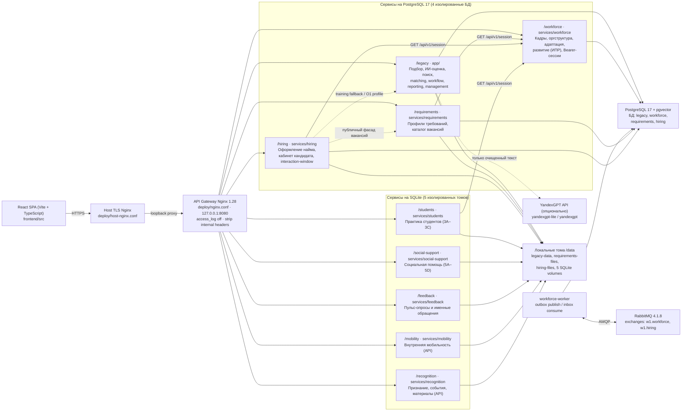

# Архитектура платформы «Кадровый ассистент»

Документ описывает **фактически реализованную** архитектуру кодовой базы репозитория `hr` на коммите `c87cbd6` (база `origin/main`, 21 ноября 2026 года). Все утверждения, имена сервисов, переменные окружения, миграции и ограничения сверены с исходным кодом и конфигурациями развёртывания.

---

## 1. Общая схема платформы

Платформа объединяет единый интерфейс на React (SPA), обратный прокси Nginx и **девять** изолированных Python-сервисов (FastAPI, Python 3.13, независимые `uv.lock`) в контуре [`deploy/compose.yaml`](../deploy/compose.yaml).

> **Фактическое подключение интерфейса (`frontend/`):** React SPA обращается через шлюз к **7 из 9** сервисов — `/legacy`, `/workforce`, `/requirements`, `/hiring`, `/students`, `/social-support` и `/feedback` (пульс-опросы по одноразовому коду). Сервисы `/mobility` и `/recognition` полностью собраны, запущены в Compose и доступны по HTTP/OpenAPI, но в текущем SPA не подключены к live API (в `frontend/src/components/employee/Care.tsx` показан локальный прототип). Единое окно взаимодействия (`interaction-window`) реализовано на сервере (`hiring` + `legacy`) и включается отдельным профилем [`deploy/compose.interaction.yaml`](../deploy/compose.interaction.yaml) без отдельного UI.

---

## 2. Реестр всех девяти сервисов (`deploy/compose.yaml`)

Каждый сервис работает в собственном контейнере на базе [`deploy/Dockerfile`](../deploy/Dockerfile) со своим окружением `uv sync --locked --no-dev`, запускается через [`deploy/runtime.py`](../deploy/runtime.py) (один worker Uvicorn, `--root-path /<service>`, `--no-access-log`) и не публикует портов наружу — весь HTTP-трафик идёт через Nginx Gateway (`deploy/nginx.conf`), снимающий первый сегмент пути (`/<service>/...` → `/...`).

| Сервис | Каталог | URL-префикс | Хранилище и миграции | Брокер / файлы | Реальный способ авторизации в `deploy/compose.yaml` | Подключён к SPA и честные границы этапа 1 |
|---|---|---|---|---|---|---|
| **legacy** | [`app/`](../app/) | `/legacy` | PostgreSQL 17 + `pgvector` (БД `legacy`), Alembic `0001`–`0015` | Том `legacy-data` (`/data/annual-reports`); опционально YandexGPT | `X-User-Login` (`hr_demo`, `admin_demo`, `dept_demo`, `dept2_demo` — учебная подпись без пароля); рабочий поиск — `HR_SEARCH_WORK_TOKEN`; рабочие годовые отчёты — `HR_REPORTS_WORK_TOKEN` / `HR_REPORTS_WORK_SCOPE` | **Да.** Чтение Этапа 1 без заголовка; действия подбора/аналитики требуют `X-User-Login`. При активном `INTERACTION_GATEWAY_KEY` шлюз закрывает `/legacy/` снаружи и пропускает только доверенный сервис `hiring`. |
| **workforce** | [`services/workforce/`](../services/workforce/) | `/workforce` | PostgreSQL 17 (БД `workforce`), Alembic `0001`–`0006` | RabbitMQ 4.1.8 + фоновый `workforce-worker` (`outbox`/`inbox`) | `AUTH_MODE=workforce`: `POST /api/v1/sessions` (логин роли + пароль `123` на стенде) → непрозрачный Bearer-токен (в БД хранится SHA-256). В автономном `AUTH_MODE=fixture` допускается `Bearer fixture:<login>` | **Да.** Источник сессий для 4 сервисов. Пароли стенда фиксированные учебные (`deploy/seed-roles.sh`). Записи сериализованы блокировкой организации (`lock_organization`). |
| **requirements** | [`services/requirements/`](../services/requirements/) | `/requirements` | PostgreSQL 17 (БД `requirements`), Alembic `0001`–`0002` | Том `requirements-files` (`/data/files`); код `OutboxRelay` в RabbitMQ есть, но `OUTBOX_POLL_INTERVAL_SEC=0` | `AUTH_MODE=workforce`: проверяет Bearer-токен через `GET http://workforce:8000/api/v1/session` (при недоступности Workforce — `503`) | **Да.** Автономный этап 1 (`implementation_stage=1`, `integration_mode=standalone`). Не подменяет загрузчик `app.requirements` в `legacy` автоматически. |
| **hiring** | [`services/hiring/`](../services/hiring/) | `/hiring` | PostgreSQL 17 (БД `hiring`), Alembic `0001`–`0004` | Том `hiring-files` (`/data/files`); без брокера (`broker=not_used`) | `AUTH_MODE=workforce`: проверяет Bearer через `workforce`. В профиле `compose.interaction.yaml` переключается в `AUTH_MODE=fixture` | **Да.** `SELECTION_SOURCE=manual-confirmed`, `transfer_mode=manual`: передача в Workforce подтверждается HR вручную (`record-assignment`), автоматического обмена по RabbitMQ на этапе 1 нет. |
| **students** | [`services/students/`](../services/students/) | `/students` | SQLite (`/data/students.db`), Alembic `0001` | Том `students` | `STUDENTS_AUTH_MODE=workforce`: проверяет Bearer через `http://workforce:8000/api/v1/session` (в локальном дефолте без Compose — `fixture`) | **Да.** Сериализация записи через `BEGIN IMMEDIATE` на уровне файла SQLite. Карьерный пакет (`prepared`) не передаётся в архив `legacy` автоматически. |
| **social-support** | [`services/social-support/`](../services/social-support/) | `/social-support` | SQLite (`/data/support.sqlite3`), инициализация схемы v1 в приложении | Том `social-support` (`/data/originals`, файлы до 10 MiB, SHA-256) | Только `Bearer fixture:<login>` из локального `fixtures/actors.json` | **Да** (`SupportPage`). Учебное правило `support-training-v1` создаётся при старте. Не подключён к единой сессии Workforce и бухгалтерским системам. |
| **feedback** | [`services/feedback/`](../services/feedback/) | `/feedback` | SQLite (`/data/feedback.db`), инициализация схемы в приложении | Том `feedback` | Управленческие и именные маршруты — `Bearer demo-<actor>` (SHA-256 в таблице `actors`); подача ответа пульса — **без сессии**, по одноразовому коду (`POST /cycles/{id}/responses`) | **Частично** (`Surveys.tsx` подключён к публичным формам/кодам/результатам с `credentials: 'omit'`). Именные обращения (`confidential-cases`) и кабинет организатора — API-only. |
| **mobility** | [`services/mobility/`](../services/mobility/) | `/mobility` | SQLite (`/data/mobility.db`), Alembic `0001` | Том `mobility` | Только `Bearer fixture:<login>` из локального `fixtures/actors.json` | **Нет (API-only).** Локальный fixture-источник назначений руководителей; UUID акторов несовместимы с общими fixtures Workforce без явной таблицы соответствия. |
| **recognition** | [`services/recognition/`](../services/recognition/) | `/recognition` | SQLite (`/data/recognition.db`), инициализация схемы в приложении | Том `recognition` | Только `Bearer demo-<actor>` (SHA-256 в таблице `actors`, явный `seed_demo`) | **Нет (API-only).** Работает на синтетических акторах; не связан с Workforce, оценкой или формальными кадровыми наградами. |

---

## 3. Ключевые наукоёмкие и предметные пайплайны

### 3.1. Импорт, очистка ПДн, аудит и журналирование контактов (152-ФЗ)

Контур реализован в [`app/ingest/`](../app/ingest/) и [`app/db/`](../app/db/) ([контракт импорта](contracts/import.md), [модуль ingest](modules/ingest.md)).

1. **Три раздельных слоя данных кандидата:**
   - `source_documents` — неизменяемый исходник (SHA-256, `source_path` в Unicode NFC, тип документа: `resume`, `vacancy_posting`, `job_description`, `competency_matrix`, `regulation`, `other`). Поддерживаются TXT (UTF-8/UTF-16/UTF-32/CP1251), DOCX (XML без дублирования объединённых ячеек) и PDF с текстовым слоем; сканы без текстового слоя уходят в `quarantined` (`PDF_NEEDS_REVIEW`).
   - `candidate_pii` — вынесенная 1:1 таблица персональных данных (`full_name`, `phone`, `email`, `links`, `gender`, `age`, `birth_date`, `city`).
   - `candidate_texts` — версионированный очищенный текст (`version`, `is_current`, `redaction_method = 'ingest-rules v2'`). Только он передаётся в LLM, поиск и API цитат.
2. **Детерминированная очистка без нейросетей (`app/ingest/redact.py`):**
   - Удаляет email, телефоны (включая неразрывные дефисы/пробелы), ссылки на профили и любые URL с путём (`v2`: Google Drive/Docs, Figma, Notion, Яндекс.Диск, личный хостинг), сохраняя сайты компаний без пути и токены технологий (`ASP.NET/Core`, `Node.js/Express`, декораторы `@pytest.mark`, `@Override`).
   - Разбирает шапку hh.ru («Женщина, 48 лет, родилась…», «ФИО N», «Кандидат №N»), подписанные поля и имена по подсказкам с морфологическим словарём `pymorphy3` (распространяя найденные ФИО во всех падежах по всему тексту).
   - Самопроверка после очистки: если в тексте осталась цепочка из 10–12 цифр, телефон, email, дата рождения, найденное ПДн или почти не осталось текста, запись отправляется в `quarantined` и в модель не попадает.
   - Каждый файл импортируется в отдельной точке сохранения (`SAVEPOINT`): сбой одного файла не оставляет частичного кандидата.
   - Из «Истории общения с кандидатом» (`app/ingest/history.py`) извлекаются `posting_title` и `applied_at` основного отклика, а прочие записи сохраняются как внешние исторические отклики (`source = history`, `vacancy_id = NULL`, дедупликация индексом `uq_applications_history`).
3. **Независимый аудит очистки (`app/ingest/audit.py`):** запускается отдельной CLI-командой `uv run python -m app.ingest.audit` с независимыми широкими шаблонами и сверкой каждого очищенного текста с таблицей `candidate_pii` того же кандидата.
4. **Слепой режим и журналирование контактов (`app/db/repository.py`, `app/api/routes.py`, `app/api/handoff.py`):**
   - В LLM, поиск, карточку для роли `department` и анонимные маршруты поля `candidate_pii` и `source_documents.raw_text` никогда не передаются.
   - При чтении карточки или списка откликов ролями `hr`/`admin` (в `app/api/routes.py`) обращение к контактам проходит исключительно через `repo.get_candidate_pii(session, candidate_id, user_id=user.id, purpose=...)`, что в той же транзакции записывает событие `AuditAction.VIEW_PII` в `audit_log` с указанием цели.
   - При сборке сводки для департамента (`app/api/handoff.py`) модуль проверяет заметки HR и ответы интервью против `CandidatePii` и регулярных выражений контактов — заметки, содержащие ПДн или контакты кандидата, исключаются из сводки и Markdown целиком.

### 3.2. Оценка (`assessment-2.0.4`), реестр публикаций, требования и гайд интервью (`guide-v2`)

Контур реализован в [`app/assessment/`](../app/assessment/), [`app/postings/`](../app/postings/), [`app/requirements/`](../app/requirements/) и [`app/interview/`](../app/interview/) ([контракт оценки](contracts/assessment.md), [реестр публикаций](contracts/posting-position-register.md), [гайд интервью](contracts/interview.md)).

Ключевой архитектурный принцип — **жёсткое разделение ответственности между LLM и детерминированным кодом**:

| Что делает LLM (`app/ai/client.py`, YandexGPT) | Что вычисляет и проверяет только код |
|---|---|
| Извлекает структурированную карточку `CandidateCard` (`card-v2`, `yandexgpt-lite/latest`, `temperature=0`) из `<resume_text>` (с защитой от prompt injection: текст резюме помечен как чистые данные) | Проверяет применимость публикации (`app/postings/service.py`) до вызова модели: при `mismatch`/`unresolved` основной отбор пишет `skipped` и не тратит вызов LLM |
| Извлекает факты и дословные цитаты по формальным требованиям и `screening`-индикаторам (`assess-v4`, `yandexgpt/latest`, `auto` json_schema → prompt_json fallback) | Ищет точные границы цитаты в текущей версии `candidate_texts` и вычисляет как кодовые точки Python (`start:end`), так и индексы UTF-16 для JavaScript (`utf16_start:utf16_end`, `app/assessment/verification.py`) |
| Извлекает периоды работы (`start`/`end`/`is_current`/`kind`) и заявления об общем опыте | Считает стаж включительными месяцами, сливает пересекающиеся интервалы и вычисляет гарантированную и верхнюю границы `[L, U]` относительно фиксированного месяца `as_of` (`app/assessment/experience.py`) |
| Возвращает статус альтернатив (нормализуя `unknown` → `no_info` на границе схемы) | Применяет скоупированные отрицания опыта (`assessment-2.0.3`: «В тестировании ПО опыта нет» опровергает QA, но оставляет `unknown` для Python) и правило курса (`assessment-2.0.4`: номер курса без явного «студент старших курсов» даёт `unknown`) |
| — | Понижает неподтверждённый вывод без годной цитаты до `unknown` (`confirm_result`), оставляет документальные `met` предварительными (`is_preliminary = true`), считает группы `same_as` (`app/assessment/counters.py`) без выдуманных общих процентов |
| — | Рассчитывает **светофор и порядок откликов** (`app/assessment/ranking.py`): `ready` (🟢) → `clarify` (🟡) → `not_met` (🔴) → `needs_action` (⚪) по детерминированным лексикографическим ключам без весов |
| — | Определяет устаревание оценки единой функцией `app/assessment/state.py::resolve_states`: `text_changed`, `algorithm_changed` (смена `ALGORITHM_VERSION` или `prompt_version`), `profile_changed` |
| Генерирует формулировки уточняющих вопросов и единого ядра интервью (`guide-v2`, `app/interview/generate.py`) по заголовкам пробелов и критериям `acceptance`, **не получая текст резюме** | Детерминированно собирает и приоритизирует пробелы (`app/interview/gaps.py`, бюджет по умолчанию 6 вопросов, стабильный хеш `gap_ref_id`), кеширует единое ядро ядра рубрики на версию профиля и переносит ответы при перегенерации гайда (`app/api/interview.py`) |

Загрузчик профилей [`app/requirements/`](../app/requirements/) валидирует формат `requirement-draft/1.0` и пакет `requirement-profile-review/0.2` (сверка SHA-256 оригиналов ДИ/матриц, адресов абзацев и дословности цитат), работает с `SAVEPOINT` и блокировкой должности `FOR UPDATE`, по умолчанию запускается в `dry-run` и **никогда** не утверждает рабочий профиль автоматически — утверждение выполняется отдельной командой действующего `hr`/`admin` с фиксацией основания.

### 3.3. Поиск кандидатов: BM25 + локальный E5 + RRF (`app/search/`)

Контур реализован в [`app/search/`](../app/search/) ([контракт](contracts/search.md), [инструкция](modules/search.md)).

- **Нарезка и индексация (`text.py`, `storage.py`):** очищенный текст (без архивного подвала и без блока истории общения hh.ru) режется на секции и окна (`chunk-v1`). Сохраняются составные технические токены (`25-ФЗ`, `1С`, `C++`, `Node.js`) и короткие прямые отрицания.
- **Лексическая ветка (`ranking.py`):** BM25 (`k1 = 1.2`, `b = 0.75`, отсечка `1e-9`) с обязательными точными терминами (`required_terms`) и структурными фильтрами (навыки из карточки, актуальный резерв).
- **Плотная ветка (`encoder.py`):** локальный энкодер `intfloat/multilingual-e5-small` (закреплённая ревизия `614241f622f53c4eeff9890bdc4f31cfecc418b3`, 384 измерения, окно 512 токенов, exact cosine в PostgreSQL с `pgvector`, без HNSW-индекса на этапе 1). Ключ индекса содержит модель, ревизию и версию нарезки; при обновлении `candidate_texts` устаревшие векторы автоматически исключаются.
- **Слияние:** Reciprocal Rank Fusion (`k = 60`) по лучшим фрагментам каждого кандидата с выдачей проверяемых границ `utf16_start`/`utf16_end`.
- **Почему BM25 включён по умолчанию (`HR_SEARCH_SEMANTIC_ENABLED=false`):** на зафиксированном контрольном бенчмарке [`search-evaluation-v1.json`](modules/search-evaluation-v1.json) (см. [EVALUATION.md](EVALUATION.md)) калиброванный порог `0.94` (минимальный порог без ложных срабатываний на запросах без ответа — от `0.82` на калибровке, выбран `0.94`) дал 0 дополнительных релевантных находок на перефразировании при росте медианной задержки с `4,33 мс` (BM25) до `30,32 мс` (Hybrid) и требовании тяжёлых PyTorch/Transformers-зависимостей в образе. Поэтому семантическая ветка оставлена опциональной (включается флагом `HR_SEARCH_SEMANTIC_ENABLED=true` после рабочей разметки с HR).

Двунаправленный подбор [`app/matching/`](../app/matching/) (3A: кандидаты под вакансию, 3B: вакансии по резюме на основе кросс-оценок, 3C: неизменяемые сохранённые подборки в таблице `matching_suggestions`, миграция `0011`) использует `app.search` и `app.assessment.cross` без генерации выдуманных процентов совпадения.

### 3.4. Согласование с департаментами (`workflow`) и единое окно взаимодействия (`interaction-window`)

- **Движение этапов и защита от гонок (`app/api/workflow.py`):** переход `POST /api/v1/applications/{id}/stage` блокирует строку отклика (`SELECT ... FOR UPDATE`), сверяет `expected_seq` с последним `seq` журнала `stage_events` (при устаревшей вкладке — `409 STALE_STAGE_FORM`), запрещает переходы из финальных этапов и работает только над прямыми откликами (`source = response`).
- **Передачи и SLA по производственному календарю (`app/api/handoff.py`, `app/db/calendar.py`):** при отправке кандидату создаётся снимок сводки (без ПДн) и запись `handoff_attempts`. Дедлайн рассчитывается как **10 рабочих дней** (`HANDOFF_FEEDBACK_DEADLINE_BUSINESS_DAYS=10`), напоминание «скоро срок» — с **7-го рабочего дня** (`HANDOFF_FEEDBACK_REMINDER_BUSINESS_DAY=7`) по таблице `production_calendar_days` (праздники и переносы РФ на 2025–2027 годы из `app/db/seed.py`). Продление срока проверяет `expected_due_date`, сохраняет причину и историю переносов; ответ департамента (`department_feedback`) версионируется через `supersedes_id` и **не меняет** этап отклика автоматически.
- **Единое окно взаимодействия (`interaction-window`, [`docs/modules/interaction-window.md`](modules/interaction-window.md)):** реализовано на сервере в `services/hiring` (композиция) + `app/api/interaction.py` (миграция `0014` в `legacy`: `FeedbackReview`, отзыв доступа к конкретной `HandoffAttempt`, Q-ref с `event_sequence` для дополнений кандидата). Включается **только явно** через отдельный оверлей [`deploy/compose.interaction.yaml`](../deploy/compose.interaction.yaml) (синтетический контур O1/training):
  - `deploy/interaction-nginx-deny.conf` закрывает `/legacy/` снаружи (`403`);
  - `deploy/nginx.conf` принудительно очищает клиентские заголовки `X-Interaction-Gateway-Key` и `X-Interaction-User-Id`;
  - `hiring` обращается к `legacy` по фиксированному allowlist, передавая внутренний ключ и серверный `mapping.json` (проверяющий неизменный `User UUID` и `training`-принадлежность объекта);
  - поддерживает частичную деградацию (`200` + `partial` при недоступности одного из двух источников, `503` при отказе всех применимых), подписанные курсоры пагинации и жёсткие бюджеты (`1s` connect / `2s` read / `3s` overall, лимит 256 KiB на источник). Отдельный UI для единого окна в поставку `c87cbd6` не входит.

### 3.5. Аналитика, отчётность (`reporting`) и кадровая картина (`management`)

Контур реализован в [`app/reporting/`](../app/reporting/), [`app/management/`](../app/management/) и [`app/api/analytics_read.py`](../app/api/analytics_read.py) ([контракт reporting](contracts/reporting.md), [модуль management](modules/management.md)).

1. **Годовые снимки (`app/reporting/`):**
   - `store.py` публикует каждый отчёт атомарно (`NamedTemporaryFile` → `fsync` → `os.link`/`os.rename`) в content-addressed каталог (`HR_REPORTS_DIR/{demo,work}/<sha256>.json`), где `snapshot_id` — SHA-256 канонического JSON. При каждом чтении хеш перепроверяется (`InvalidSnapshot` при порче).
   - **Модель полноты (`engine.py`):** каждая ячейка отчёта несёт явный статус `complete` (подтверждённый интервал покрытия без недатированных записей), `partial` (есть факты, но интервал неполный — нижняя граница), `unavailable` (`null`, источник без заявленного покрытия — принципиально отличается от подтверждённого нуля `0 complete`) или `future`.
   - Экспорт в Excel (`excel.py`, `analysis_excel.py`) формирует книгу с листами «Итоги», «Помесячно», «Вакансии», «Методика», «К докладу» и встроенными диаграммами.
2. **Кадровая картина для руководства (`app/management/`):**
   - **4A (`/api/v1/management/overview`):** оперативная сводка за период по `Europe/Moscow` (встречи `held_count` строго по `held_at`, `no_answer_count` отдельно, воронка, явная карта доступности источников: `legacy-hr` — `available`, `workforce`/`hiring`/`practice` — `unavailable`).
   - **4B (`/api/v1/management/annual-reports`, миграция `0012`):** собирает обезличенный пакет (`manifest.json`, `applications.csv`, `phone_interviews.csv`) из БД `legacy`, прогоняет его через `app.reporting` и регистрирует неизменяемый выпуск; поздняя правка создаёт новый `snapshot_id`, не трогая прежний.
   - **4C (`/api/v1/management/plans`, миграция `0013`):** неизменяемый плановый снимок потребностей с расчётом **независимого покрытия** методом максимального паросочетания на двудольном графе «место — подтверждённый человек» (алгоритм увеличивающих путей Куна в `app/management/plans.py`), выявлением концентрационного риска (один человек на две потребности) и обезличенной управленческой проекцией `/summary`.
3. **Оперативный дашборд (`app/api/analytics_read.py`):** `GET /api/v1/analytics/dashboard` считает реальные недельные ряды, каналы, этапы, причины отказов и просрочки по вакансиям напрямую из БД `legacy`.

### 3.6. Новые сервисы жизненного цикла сотрудника и кандидата (`services/*`)

- **`workforce` (`services/workforce/`):** владелец кадровой основы (организации, подразделения, сотрудники с внешними `SourceRef`, назначения, переводы, исправления), вводной адаптации (`workforce/onboarding/`, миграция `0003`: версионные шаблоны со снимком шагов и отметками ознакомления сотрудника) и индивидуального развития / ИПР (`workforce/development/`, миграции `0004`–`0006`: приватная цель с версиями → шаринг руководителю → согласованный план со снимком цели → попытки сдачи и неизменяемые ревью проверяющего → закрытие → выборочный `ResultPackage` с `delivery_status=not_sent`). Содержит рабочий транзакционный `outbox`/`inbox` и отдельный контейнер `workforce-worker` (`pika`, persistent, `confirm_delivery`, экспоненциальный backoff, dead-letter очередь `w1.workforce.dead`), слушающий `w1.hiring / employment.ready` и публикующий в `w1.workforce`.
- **`hiring` (`services/hiring/`):**
  - Дело оформления найма (миграция `0001`): комплект документов с неизменяемыми версиями файлов (PDF/JPEG/PNG, атомарная запись `tmp → fsync → rename`), возвраты с причиной, `ready` → `start` → ручная регистрация кадрового результата `record-assignment` (`transfer_mode=manual`) → сверка расхождений при `correct-start`. Частичный уникальный индекс допускает только одно активное (не `withdrawn`) дело на `application_ref`.
  - Кабинет кандидата (`hiring/portal.py`, миграции `0002`–`0004`, волны 5A–5C): собственное обращение `ОБР-NNNNNN`, снимок подачи, запрос уточнений HR и дополнение (с Q-ref), выбор вакансии, ручная регистрация рассмотрения в подборе (`manual-confirmed` с `identity_basis`), публичные исходы (`continue`/`declined`/`no_open_opportunity`/`completed`) и сообщения с отметкой прочтения.
- **`requirements` (`services/requirements/`):** автономный жизненный цикл профилей (загрузка TXT/DOCX/PDF с отдельной ручной транскрипцией сканов, раздельные `revision` и `content_revision`, привязка согласования к редакциям контента и источников, сериализованное утверждение со снимком `sources_snapshot`, таблица `outbox_events`) + каталог вакансий (`catalog.py`, миграция `0002`, привязка к `is_current` профилю при публикации и публичная 5-польная проекция).
- **`students` (`services/students/`):** полный цикл практики (3A–3C): публикация мест с контролем вместимости и нагрузки наставника внутри `BEGIN IMMEDIATE`, заявки студентов, задания с версиями критериев, попытки сдачи и неизменяемые отзывы наставника, раздельные итог практики и внешний вузовский зачёт, карьерный пакет выбранных подтверждённых результатов (`education_status=unconfirmed`).
- **`social-support` (`services/social-support/`):** личные заявления на материальную помощь (5A–5D) со строгим разделением видимости (`applicant` vs `internal`), минимальной очередью координатора, раздельными назначениями специалиста/секретаря/исполнителя, правилом отвода (саморассмотрение запрещено), версионными решениями, выпиской по белому списку полей и безопасной отдачей файлов (`attachment`, `nosniff`, `no-store`).
- **`feedback` (`services/feedback/`):** два структурно несвязанных контура в SQLite:
  1. *Пульс-опросы:* организатор выпускает до `eligible_count` случайных кодов (`secrets.token_urlsafe(32)`), хранятся только их SHA-256 в `access_codes`. При подаче `POST /cycles/{id}/responses` **отсутствует** зависимость аутентификации; в `responses` пишутся только случайный `id`, `cycle_id`, `group_key`, `answers`, `topic_key` — без актора, кода, времени и метаданных сети. Публикация после закрытия цикла применяет пороги подавления малых групп и категорий, создаёт единый неизменяемый выпуск без произвольных фильтров и связывает темы с мерами (`actions.py`).
  2. *Именные обращения (`confidential.py`):* отдельные таблицы `confidential_cases` / `confidential_history` без внешних ключей к пульсам; доступ строго у автора и явно выбранного `confidential_recipient` (роль HR/admin не обходит проверку).
- **`mobility` (`services/mobility/`):** временные задачи и внутренние переходы (4A–4C): приватный интерес сотрудника (невидим руководителю до согласования), версионные соглашения о времени (`conditions_revision`, запрет самосогласования, проверка назначения руководителя), участие со снимком условий, раздельные итог владельца и отзыв сотрудника, выборочный пакет и отдельное заявление на внутреннюю вакансию (`manual-confirmed`).
- **`recognition` (`services/recognition/`):** благодарности с согласием адресата и модерацией (4A), кампании и номинации с запретом самооценки (4B), семейные/общие мероприятия с транзакционным контролем вместимости и очередью ожидания (4C), закрытые одноместные сессии со специалистом и версионные учебные материалы с отзывом URL (4D).

---

## 4. Безопасность, эксплуатация и CI/CD

| Механизм | Реализация в репозитории |
|---|---|
| **Изоляция контейнеров** | [`deploy/compose.yaml`](../deploy/compose.yaml), [`deploy/Dockerfile`](../deploy/Dockerfile): `cap_drop: [ALL]`, `security_opt: ["no-new-privileges:true"]`, `init: true`, непривилегированный пользователь `app` (UID `10001`), порты БД/брокера/API не публикуются на хост, gateway слушает только `127.0.0.1:8080`. |
| **Защита заголовков и логов** | [`deploy/nginx.conf`](../deploy/nginx.conf), [`deploy/host-nginx.conf`](../deploy/host-nginx.conf), [`deploy/runtime.py`](../deploy/runtime.py): `access_log off` и `--no-access-log` (защита кодов опросов и ID документов), `server_tokens off`, `Cache-Control: no-store`, принудительная очистка клиентских `X-Interaction-Gateway-Key` и `X-Interaction-User-Id`, лимит тела `21m`, `proxy_next_upstream off`. |
| **Изоляция БД и контуров** | [`deploy/init-databases.sh`](../deploy/init-databases.sh): 4 раздельные БД и роли в PostgreSQL 17 (`REVOKE ALL ON DATABASE ... FROM PUBLIC`), расширение `vector` ставит только администратор в БД `legacy`. В `legacy` строго разделены контуры `working` и `training` (`candidates.is_synthetic`, `requirement_profiles.is_synthetic`), не пересекающиеся в выборках, поиске и отчётах. |
| **Миграции и проверки готовности** | Одноразовые init-контейнеры `*-migrate` (`restart: 'no'`, `service_completed_successfully`) запускают Alembic до старта API, исключая гонки миграций. Healthcheck [`deploy/runtime.py check`](../deploy/runtime.py) проверяет не только HTTP `/openapi.json`, но и наличие таблиц SQLite (в `mode=rw`) либо `SELECT version_num FROM alembic_version` в БД. |
| **Резервное копирование и smoke** | [`deploy/backup.sh`](../deploy/backup.sh) с `umask 077` останавливает все пишущие сервисы для согласованного снимка (`pg_dumpall` + `tar -czf` всех 8 файловых/SQLite-томов в контейнере `--network none` + `gzip -t`), гарантированно перезапускает сервисы через `trap EXIT`. [`deploy/smoke.py`](../deploy/smoke.py) проверяет OpenAPI, Swagger-префиксы, 404, 4 `/ready`/`/health` и `401` без токена по всем 9 сервисам; [`deploy/check-sessions.py`](../deploy/check-sessions.py) проверяет общую сессию Workforce/Hiring/Requirements и её сохранность после пересоздания контейнеров. |
| **CI/CD (GitHub Actions)** | [`.github/workflows/backend.yaml`](../.github/workflows/backend.yaml): на PR/push собирает 9 образов по `uv.lock`, валидирует `docker compose config`; на `main` пушит образы в `ghcr.io` с тегом полного SHA, загружает bundle без секретов и при `DEPLOY_ENABLED=true` выкатывает через [`deploy/registry-release.sh`](../deploy/registry-release.sh) (с отказом на устаревший SHA). [`.github/workflows/frontend.yaml`](../.github/workflows/frontend.yaml): запускает `deploy/test_frontend_release.py`, `npm ci`, `npm run build` (Node 22), ждёт завершения matching backend workflow при изменениях в одном коммите, деплоит через `deploy/frontend-receive.py` и проверяет `https://gorky.bond/version.json`. |

---

## 5. Архитектурные компромиссы этапа 1 и что нужно для продакшена

Команда сознательно зафиксировала границы этапа 1, чтобы обеспечить предсказуемый, проверяемый запуск всех девяти доменов без скрытых заглушек:

1. **Единая аутентификация и SSO во всех 9 сервисах.**
   - *Сейчас:* общая Bearer-сессия Workforce работает в 4 сервисах (`workforce`, `requirements`, `hiring`, `students`), но на стенде используются учебные пароли `123` и фиксированный список ролей; `legacy` использует учебный заголовок `X-User-Login` (плюс раздельные серверные токены поиска/отчётности), `social-support` и `mobility` — `Bearer fixture:<login>`, `recognition` и `feedback` — `Bearer demo-<actor>`. Автоматическая склейка по UUID запрещена (в разных локальных fixtures совпадающие UUID относятся к разным ролям).
   - *Для продакшена:* внедрить единый IdP / OIDC (или SSO заказчика) с личными учётными записями, управлением ролями/сроками/замещениями и явной таблицей сопоставления `actor_id ↔ employee_id` для всех 9 сервисов; перевести `legacy` с `X-User-Login` на проверку подписанных токенов/сессий.
2. **Миграция 5 SQLite-сервисов на PostgreSQL.**
   - *Сейчас:* `students`, `mobility`, `social-support`, `recognition` и `feedback` хранят данные в отдельных файлах SQLite (с сериализацией записи через `BEGIN IMMEDIATE` и одним Uvicorn worker). Это упрощает автономную доставку, но ограничивает горизонтальное масштабирование и конкурентную нагрузку.
   - *Для продакшена:* перевести их на отдельные БД PostgreSQL (`students` и `mobility` уже используют SQLAlchemy + Alembic и содержат ветку `pg_advisory_xact_lock`, остальные три потребуют адаптации слоя `sqlite3` и добавления миграций Alembic).
3. **Автоматический event-driven обмен между сервисами.**
   - *Сейчас:* инфраструктура RabbitMQ и `workforce-worker` (`outbox`/`inbox`, dead-letter, retry) работает в `workforce`, а в `requirements` код `OutboxRelay` выключен (`OUTBOX_POLL_INTERVAL_SEC=0`). Передача `legacy → hiring → workforce` и передача пакетов из `students`/`development`/`mobility` в архив выполняются через явное ручное подтверждение HR (`transfer_mode=manual`, `manual-confirmed`).
   - *Для продакшена:* включить этап 2 в `hiring` (публикация `employment.ready`, приём `assignment.registered` / `assignment.review-resolved`, собственный outbox/inbox) и включить `OutboxRelay` в `requirements`, проверив сквозной AMQP-контур под сбоями и рестартами.
4. **Замыкание UI и производственная эксплуатация.**
   - *Сейчас:* `mobility`, `recognition` и серверный `interaction-window` не подключены к React SPA; `legacy` использует локальный файловый каталог для годовых снимков, а `hiring`/`requirements`/`social-support` — локальные Docker-тома для документов; `backup.sh` останавливает сервисы на время снимка.
   - *Для продакшена:* подключить экраны `mobility`, `recognition`, `interaction-window` и именных обращений `feedback`; вынести файлы в S3-совместимое хранилище (или отказоустойчивый том с регулярной проверкой восстановления резервных копий); утвердить реальные рабочие профили должностей и 7 кадровых соответствий публикаций силами уполномоченного HR.

---

## Связанные документы в репозитории

- [Реестр проверок, тестов и бенчмарков](EVALUATION.md)
- [Инструкция серверной сборки (`deploy/`)](modules/deployment.md)
- [Контракты сервисов и API](contracts/README.md)
- [Устройство модулей `app/` и `services/`](modules/api.md)
